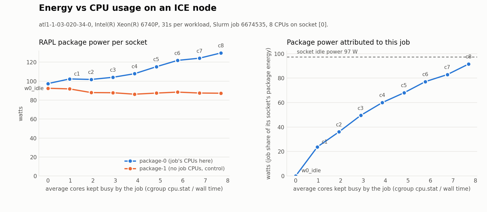
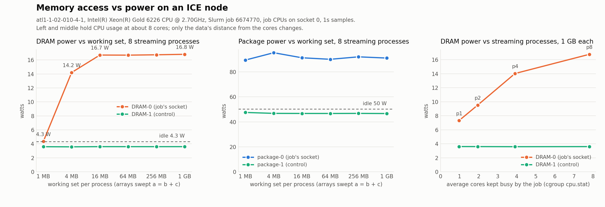

# rapl

Read Intel RAPL (Running Average Power Limit) energy counters on a Linux node
and record them for a Slurm job on Georgia Tech's ICE cluster.

## Files

- `rapl_reader.py` - samples every RAPL domain in `/sys/class/powercap`
  (package, dram, ...) at a fixed interval, for a fixed duration or while a
  command runs. Handles counter wraparound. Writes `.csv`, `.json`, `.md`.
- `workload.py` - small CPU-bound workload so there is something to measure.
- `run_rapl.sbatch` - Slurm script: idle baseline, then the workload, both
  measured. Results go to `results/job_<jobid>_<node>/`.
- `results/` - collected data from real ICE runs.

## Usage on ICE

```bash
ssh mtokuda3@login-ice.pace.gatech.edu
git clone https://github.com/Tokuda17/rapl.git && cd rapl
sbatch run_rapl.sbatch          # defaults: 8 cpus, 15s idle, 30s load
squeue -u $USER
cat results/job_*/summary.md
```

Tunables are environment variables: `IDLE_S`, `LOAD_S`, `INTERVAL`, for example
`LOAD_S=120 sbatch --cpus-per-task=32 run_rapl.sbatch`.

## Standalone use

```bash
python3 rapl_reader.py --list                                  # show domains
python3 rapl_reader.py --duration 10 --interval 1 --out idle   # sample 10s
python3 rapl_reader.py --interval 0.5 --out run -- ./my_prog   # measure a command
```

## Notes

- RAPL counters are per socket. The job's node is shared unless you request
  `--exclusive`, so other users' jobs on the same node contribute to the numbers.
- Reading `energy_uj` needs read permission on the sysfs files. On ICE (RHEL 9,
  kernel 5.14) they are world-readable. On many desktop kernels they are root-only.

## Collected data: job 6673551 (2026-10-30)

Run on ICE node `atl1-1-02-003-19-1` (2x Intel Xeon Gold 6226, 24 cores, kernel 5.14, RHEL 9), partition coc-cpu, 8 CPUs allocated. Full data in [`results/job_6673551_atl1-1-02-003-19-1/`](results/job_6673551_atl1-1-02-003-19-1/).

RAPL domains found:

```
intel-rapl:0     package-0            max_energy_range_uj=262143328850  /sys/class/powercap/intel-rapl:0/energy_uj
intel-rapl:0:0   package-0/dram       max_energy_range_uj=65712999613  /sys/class/powercap/intel-rapl:0:0/energy_uj
intel-rapl:1     package-1            max_energy_range_uj=262143328850  /sys/class/powercap/intel-rapl:1/energy_uj
intel-rapl:1:0   package-1/dram       max_energy_range_uj=65712999613  /sys/class/powercap/intel-rapl:1:0/energy_uj
```

### RAPL summary: idle baseline (15s)

- host: `atl1-1-02-003-19-1.pace.gatech.edu`  cpu: Intel(R) Xeon(R) Gold 6226 CPU @ 2.70GHz
- duration: 15.00 s, samples: 17, interval: 1.0 s

| domain | energy (J) | avg power (W) |
|---|---:|---:|
| package-0 | 708.397 | 47.22 |
| package-0/dram | 331.045 | 22.07 |
| package-1 | 777.245 | 51.81 |
| package-1/dram | 308.386 | 20.56 |

### RAPL summary: cpu workload (8 procs, 30s)

- host: `atl1-1-02-003-19-1.pace.gatech.edu`  cpu: Intel(R) Xeon(R) Gold 6226 CPU @ 2.70GHz
- duration: 31.00 s, samples: 33, interval: 1.0 s
- command: `python3 workload.py --seconds 30 --procs 8` (exit 0)

| domain | energy (J) | avg power (W) |
|---|---:|---:|
| package-0 | 1838.373 | 59.30 |
| package-0/dram | 697.724 | 22.51 |
| package-1 | 1740.829 | 56.15 |
| package-1/dram | 645.827 | 20.83 |
Per-second cumulative energy is in `results/job_6673551_atl1-1-02-003-19-1/idle.csv` and `results/job_6673551_atl1-1-02-003-19-1/load.csv`; the JSON files carry the same samples plus metadata. Note the node was shared with other jobs, so the baseline is not a true idle socket.

## Energy vs CPU usage sweep: job 6674363 (2026-10-30)

`run_sweep.sbatch` runs five workloads of increasing CPU intensity on one node, each for 30 s, with `rapl_cgroup_reader.py` recording RAPL energy and the job's cgroup accounting side by side. Slurm pinned the 8 allocated CPUs to socket 0, so package-1 is an untouched control. Node `atl1-1-03-020-34-0` (2x Intel Xeon 6740P, 96 cores) was otherwise nearly idle. Full data in [`results/sweep_6674363_atl1-1-03-020-34-0/`](results/sweep_6674363_atl1-1-03-020-34-0/); an earlier identical run is in [`results/sweep_6674330_atl1-1-03-020-34-0/`](results/sweep_6674330_atl1-1-03-020-34-0/) (its attribution columns use the older whole-node formula).


| level | script | what it does |
|---|---|---|
| w0 | (none) | idle baseline, 20 s |
| w1 | `workloads/w1_light.py` | 1 process at a 20% duty cycle |
| w2 | `workloads/w2_single_core.py` | 1 process, pure-Python arithmetic loop |
| w3 | `workloads/w3_two_cores.py` | 2 processes, numpy matrix multiplies |
| w4 | `workloads/w4_half_cores.py` | 4 processes (half the allocation), numpy |
| w5 | `workloads/w5_all_cores.py` | 8 processes (full allocation), numpy |

| workload | job cores busy | socket cores busy (all users) | job share | package-0 W | package-1 W | dram-0 W | dram-1 W | attributed package J | attributed package W | peak mem MB |
|---|---:|---:|---:|---:|---:|---:|---:|---:|---:|---:|
| w0_idle | 0.00 | 0.27 | 0% | 89.3 | 84.6 | 27.9 | 32.2 | 61 | 3.0 | 11 |
| w1_light | 0.20 | 0.22 | 89% | 89.6 | 84.7 | 27.8 | 32.2 | 2451 | 79.1 | 19 |
| w2_single_core | 0.97 | 1.10 | 88% | 92.7 | 84.7 | 27.8 | 32.2 | 2690 | 86.8 | 19 |
| w3_two_cores | 1.93 | 1.98 | 98% | 96.9 | 84.7 | 27.8 | 32.2 | 2939 | 94.8 | 95 |
| w4_half_cores | 3.86 | 3.98 | 97% | 105.0 | 84.7 | 27.9 | 32.3 | 3179 | 102.5 | 174 |
| w5_all_cores | 7.72 | 7.80 | 99% | 117.5 | 84.9 | 28.2 | 32.3 | 3607 | 116.3 | 331 |

Reading the data:

- `job cores busy` comes from the cgroup's `cpu.stat` usage divided by wall time, and lands within a few percent of the intended 0.2, 1, 2, 4, 8 cores.
- Package-0 power rose from 89 W idle to 117 W with all 8 cores busy, about 3.6 W per busy core, while package-1 stayed at 85 W throughout.
- `attributed package W` is the job's share of busy CPU time on socket 0 times that socket's package power. The share model hands the job most of the socket's idle power as soon as it uses any CPU, which is why w1 jumps to 79 W for 0.2 cores of work. The marginal cost of the work itself is the rise above the 89 W idle line.
- DRAM power barely moved (27.8 to 28.2 W on socket 0): these workloads fit in cache.

To regenerate the plot and table locally (needs matplotlib): `python3 plot_sweep.py results/sweep_6674363_atl1-1-03-020-34-0`.

## Energy vs cores, 1 through 8: job 6674535 (2026-10-30)

`run_cores_sweep.sbatch` repeats the measurement with one numpy process per core count, 1 to 8, using `workloads/ncores.py --procs N`. Same node (`atl1-1-03-020-34-0`, socket 0, CPUs 20-27), 30 s per level. Full data in [`results/cores_6674535_atl1-1-03-020-34-0/`](results/cores_6674535_atl1-1-03-020-34-0/).



| workload | job cores busy | socket cores busy (all users) | job share | package-0 W | package-1 W | dram-0 W | dram-1 W | attributed package J | attributed package W | peak mem MB |
|---|---:|---:|---:|---:|---:|---:|---:|---:|---:|---:|
| w0_idle | 0.00 | 3.06 | 0% | 97.4 | 92.5 | 27.9 | 32.4 | 1 | 0.0 | 12 |
| c1 | 0.97 | 4.17 | 23% | 102.3 | 91.8 | 27.9 | 32.9 | 737 | 23.8 | 56 |
| c2 | 1.93 | 5.42 | 36% | 101.8 | 87.9 | 28.0 | 32.6 | 1117 | 36.0 | 96 |
| c3 | 2.90 | 6.06 | 48% | 104.1 | 87.8 | 28.0 | 32.3 | 1536 | 49.5 | 134 |
| c4 | 3.86 | 6.88 | 56% | 107.8 | 86.2 | 28.0 | 32.2 | 1861 | 60.0 | 174 |
| c5 | 4.83 | 8.09 | 60% | 115.2 | 87.4 | 28.0 | 32.5 | 2109 | 68.0 | 213 |
| c6 | 5.77 | 9.03 | 64% | 121.9 | 88.4 | 28.1 | 32.6 | 2391 | 77.1 | 252 |
| c7 | 6.75 | 10.05 | 67% | 124.2 | 87.4 | 28.1 | 32.5 | 2570 | 82.9 | 292 |
| c8 | 7.70 | 10.82 | 71% | 129.7 | 87.2 | 28.1 | 32.5 | 2838 | 91.5 | 330 |

Reading the data:

- Package-0 power climbs from 97 W idle to 130 W at 8 cores, about 4 W per added core, and the slope steepens slightly past 4 cores as the socket spends less time in low-power states. Package-1 holds near 87 W.
- Unlike the earlier sweep, other users were active on socket 0 this time (about 3 cores busy that were not ours), so the `job share` column is lower and the attributed power is a smaller slice of the socket total. Attributed power still rises linearly with cores, from 24 W at 1 core to 92 W at 8.
- The idle baseline of 97 W is 8 W above the earlier run's 89 W for the same reason: the socket was not truly idle.

## Memory access vs power: job 6674770 (2026-10-30)

`run_memory_sweep.sbatch` holds CPU usage at 8 cores and changes only how far the data is from the cores. `workloads/memstream.py` runs 8 processes, each sweeping a = b + c over three arrays (STREAM-style) sized to a working set from 1 MB to 1 GB per process. A second part fixes the working set at 1 GB and varies the process count. `rapl_cgroup_reader.py` now also records page faults, peak anonymous memory per NUMA node, and pressure-stall time from the cgroup. Node `atl1-1-02-010-4-1` (2x Intel Xeon Gold 6226, 12 cores, 1 MB L2 per core and 19.25 MB L3 per socket), job on socket 0 CPUs 3-10. Full data in [`results/mem_6674770_atl1-1-02-010-4-1/`](results/mem_6674770_atl1-1-02-010-4-1/).



| run | job cores busy | package-0 W | package-1 W | DRAM-0 W | DRAM-1 W | peak mem MB | page faults | peak anon by NUMA node (MB) | mem pressure % |
|---|---:|---:|---:|---:|---:|---:|---:|---:|---:|
| w0_idle | 0.00 | 50.2 | 47.5 | 4.3 | 3.6 | 10 | 13 | {'N0': 7.7, 'N1': 0.1} | None |
| m1 | 7.75 | 89.5 | 47.5 | 4.3 | 3.6 | 152 | 41636 | {'N0': 146.4, 'N1': 0.1} | None |
| m4 | 7.71 | 95.4 | 46.8 | 14.2 | 3.6 | 176 | 47442 | {'N0': 170.5, 'N1': 0.1} | None |
| m16 | 7.73 | 91.3 | 46.7 | 16.7 | 3.6 | 273 | 50380 | {'N0': 266.5, 'N1': 0.1} | None |
| m64 | 7.74 | 90.1 | 46.7 | 16.7 | 3.6 | 658 | 50229 | {'N0': 650.6, 'N1': 0.1} | None |
| m256 | 7.75 | 92.1 | 46.8 | 16.7 | 3.6 | 2196 | 53024 | {'N0': 2186.2, 'N1': 0.1} | None |
| m1024 | 7.82 | 91.1 | 46.7 | 16.8 | 3.6 | 8352 | 56845 | {'N0': 8330.3, 'N1': 0.1} | None |
| p1 | 0.98 | 58.0 | 47.2 | 7.3 | 3.6 | 8352 | 9845 | {'N0': 1053.3, 'N1': 0.1} | None |
| p2 | 1.96 | 63.9 | 46.6 | 9.5 | 3.6 | 8352 | 16571 | {'N0': 2092.9, 'N1': 0.1} | None |
| p4 | 3.91 | 75.9 | 46.6 | 14.0 | 3.6 | 8352 | 30008 | {'N0': 4172.0, 'N1': 0.1} | None |
| p8 | 7.82 | 91.4 | 47.1 | 16.8 | 3.6 | 8352 | 56849 | {'N0': 8330.3, 'N1': 0.1} | None |

Reading the data:

- DRAM-0 power is flat at the 4.3 W idle floor when each process's 1 MB working set fits in its core's L2 (1.0 MB on this chip, with per-process bandwidth near 50 GB/s). At 4 MB per process the 8 processes together need 32 MB, more than the socket's 19.25 MB L3 can hold, and DRAM power jumps to 14.2 W. From 16 MB upward every access streams from memory and DRAM-0 saturates at 16.7 W with about 9 GB/s per process, 72 GB/s total. That knee is the cache hierarchy's size measured by energy.
- Package-0 stayed near 90 W across the whole working-set sweep while the cgroup reported 7.7 cores busy throughout. The same CPU utilization costs the same package power whether the cores are computing from cache or stalled on memory, but the memory side adds up to 12 W on top.
- In the process sweep, DRAM-0 rises with each streaming process (7.3, 9.5, 14.0, 16.8 W for 1, 2, 4, 8) while per-process bandwidth drops from 13.4 to 9 GB/s at 8 processes, the point where the socket's memory bandwidth is exhausted.
- DRAM-1 and package-1 on the other socket never moved, and the cgroup's NUMA accounting confirms all job memory (up to 8.3 GB) sat on node 0, so DRAM-0 is the right counter.
- The `peak mem MB` column reads 8352 for p1 through p4 because `memory.peak` is a cumulative high-water mark for the cgroup and this kernel (5.14) cannot reset it. The per-NUMA-node column, sampled during each run, gives the true peak. Pressure-stall files are not exposed in the job cgroup on these nodes.

Regenerate with `python3 plot_memory.py results/mem_6674770_atl1-1-02-010-4-1`.
